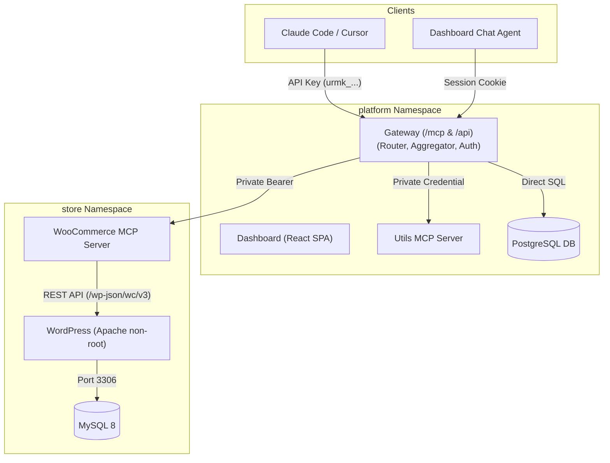

# Urumi MCP Gateway: System Architecture & Design

## 1. High-Level Overview
Urumi is a Kubernetes-native Model Context Protocol (MCP) gateway that aggregates multiple tool servers into a single secure endpoint for AI clients (Claude Code, Cursor, MCP Inspector) and an in-dashboard conversational assistant.

## 2. Key Architecture Decisions & Tradeoffs

| Decision | Alternative Considered | Tradeoff & Rationale |
|---|---|---|
| **Stateless Gateway** | Server-held MCP client sessions | Allows effortless horizontal scaling and immediate API key revocation without distributed state. Cost: clients poll or re-list for tool changes rather than receiving server-sent list notifications. |
| **Namespaced Tool Scheme (`<slug>__<tool>`)** | Prefix only on collision | Consistent prefixes prevent tool naming drift when new upstreams are registered, ensuring LLM prompts remain stable. |
| **In-Process Chat Agent** | Separate microservice agent | Avoids generating and managing machine credentials; runs with the exact same `Principal`, permissions, and audit path as external clients. |
| **REST API for WooCommerce** | WP-CLI `exec` or direct SQL | REST executes full WooCommerce business logic, validations, stock triggers, and webhooks without exposing pod exec RBAC or raw database credentials. |
| **AES-256-GCM Credential Encryption** | Hashicorp Vault / Cloud KMS | Lightweight and fully self-contained on Kubernetes using a mounted 32-byte master key with fresh random nonces and server slugs as Additional Authenticated Data (AAD). |

## 3. Resilience & Failure Containment
* **Bulkheads:** Each upstream is allocated 20 in-flight execution slots using Go concurrency semaphores. A hanging upstream cannot exhaust gateway threads or starve other servers.
* **Circuit Breaker:** After 5 consecutive failures, the breaker opens for 15 seconds, immediately failing calls with `upstream_unreachable` instead of blocking for the full 30-second timeout.
* **Health Pings:** The gateway supervisor pings each enabled server every 15 seconds. If 3 pings fail consecutively, the server enters the `Unreachable` state and its tools are hidden from client listings.
* **Structured Error Contract:** Upstream timeouts and faults return formatted tool results with `isError: true` so the model can report the issue cleanly without crashing the turn.
